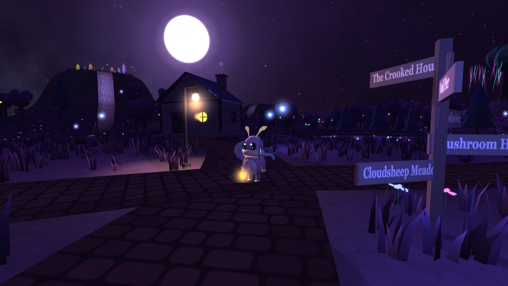

# Violet Isle



A cozy LittleJS 3D game. You are a small moth with a lantern on an island that floats through the night. Fish for things that swim between stars, swing until you touch the moon, and find what the crystals are humming about.

## Run

```sh
just play          # installs the engine if needed, serves on http://localhost:8000 and opens your browser
```

Other recipes:

| Recipe | What it does |
| --- | --- |
| `just serve` | serve the game on http://localhost:8000 (`just port=9000 serve` for another port) |
| `just install` | `npm install` the pinned engine |
| `just check` | syntax-check every script in `src/` |

Without just: `npm install && npm start`, then open http://localhost:8000.

## Controls

| Action | Keyboard | Gamepad / touch |
| --- | --- | --- |
| Walk, hold Shift to run | WASD | Left stick / left thumb |
| Jump, hold in the air to glide | Space | Button 0 / Jump |
| Use, talk, fish, sit | E | Button 2 / Use |
| Turn the camera | Drag, Z and C, scroll to zoom | Right stick / drag |
| Dream journal | J | Journal |
| Leave an activity | Q | Button 1 |

## Files

- `index.html` holds the HUD and menu markup and loads the engine and the scripts in order
- `style.css` styles the HTML layer over the canvas
- `src/` holds the game, one script per area, all sharing globals:
  - `core.js` engine settings and helpers
  - `save.js` everything the game remembers, and the storage backend it goes through (see Saving)
  - `world.js` island layout, terrain, collision solids, scenery
  - `sky.js` stars, moon and the night sky
  - `player.js` the mothling's meshes and animation
  - `controls.js` input, player physics, camera, interaction prompts
  - `fx.js` particles and ambient effects
  - `audio.js` sound effects and music
  - `ui.js` HUD, dialog, journal and menu
  - `village.js` pond, house exterior, bench, signpost, snail
  - `fishing.js` fish list and the fishing minigame
  - `activities.js` swing, chimes, light bridge and Moonlet, mushrooms, overlook, telescope, pier, sheep
  - `house.js` the house interior
  - `main.js` init, update loop, `engineInit`
- The engine is pinned to `littlejsengine@1.21.0` in `package.json`

## Saving

All persistence lives in `src/save.js`. The game keeps its progress in the `save` object and calls `writeSave()` after each change. Volume and graphics settings live under their own keys, so starting a new dream keeps them.

Those values sit in a small in-memory table of string keys. A storage backend fills that table once before the engine starts, and is told about every change. The default backend is the browser's `localStorage`, under the keys `violet-isle-dream-v1`, `violet-isle-dream-v1-vol` and `violet-isle-dream-v1-gfx`.

To save to a file under Electron or Tauri, define `window.violetIsleStorage` before the scripts load, for example in a preload script:

```js
window.violetIsleStorage = {
    load: async ()=> JSON.parse(await readSaveFile() || '{}'),   // the whole table, or {} on a first run
    write: (key, value, all)=> writeSaveFile(JSON.stringify(all)),
    remove: (key, all)=> writeSaveFile(JSON.stringify(all)),     // may return a promise; a reset waits for it
};
```

`readSaveFile` and `writeSaveFile` stand in for whatever your shell provides: Electron IPC to `fs`, or Tauri's `fs` plugin. `load` can be async, and the engine only starts once it resolves. If the backend throws, the game logs a warning and keeps running.
